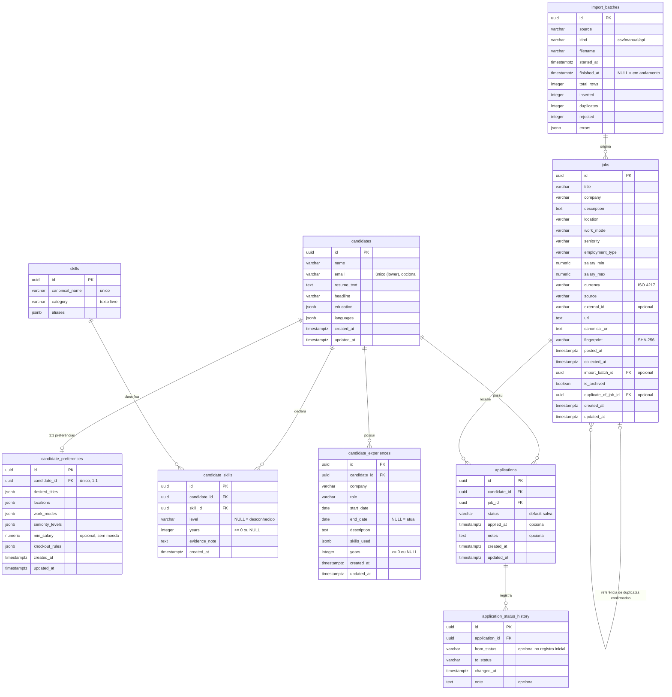

# JobPilot AI — Modelo de dados

> Estado do esquema criado pelas migrações Alembic. Atualizar sempre que uma
> migração criar/alterar tabelas (gatilho A.2 do `GUIA_DOCS_E_GIT.md`).
> Revisado em 2026-11-19 (F1-T13). A revisão Alembic ao fim da fase é `000000000004`.

## Visão geral

- **Chaves primárias:** `UUID` em todas as tabelas (ADR 0010) — evita IDs
  sequenciais expostos e facilita mesclar dados de fontes diferentes.
- **Timestamps:** `TIMESTAMPTZ` com `now()` do servidor no `INSERT`
  (`created_at`/`updated_at`); `updated_at` também usa `now()` do servidor no
  `UPDATE`. Não dependem do relógio da aplicação.
- **JSONB:** `education`, `languages`, `aliases`, listas de preferência,
  `knockout_rules` e `skills_used` guardam JSON válido no banco; a estrutura
  interna é validada pelos schemas Pydantic da API (F1-T02).
- **Exclusão em cascata:** tudo que pertence ao candidato é removido junto
  (`ON DELETE CASCADE`). O catálogo `skills` **não** é apagado em cascata.
- **Vagas:** `jobs` guarda a vaga já normalizada; `import_batches` registra a
  origem e os contadores de cada lote. Apagar um lote ou a vaga original de uma
  duplicata usa `ON DELETE SET NULL` — nada é perdido em cascata.
- **Migrações:** `migrations/versions/000000000002_profile_tables.py` (perfil) e
  `000000000003_job_tables.py` (vagas), seguidas por
  `000000000004_application_tables.py` (candidaturas). Cada revisão tem
  `upgrade` e `downgrade`.

## Diagrama

## Tabelas

### `candidates`

Perfil principal; no MVP é single-user, mas o esquema já é multiusuário.

| Coluna | Tipo | Regras |
|--------|------|--------|
| `id` | `UUID` | PK, gerada na aplicação (`uuid4`) |
| `name` | `varchar(200)` | obrigatório |
| `email` | `varchar(320)` | opcional; normalizado (trim + minúsculas) antes de gravar |
| `resume_text` | `text` | obrigatório |
| `headline` | `varchar(200)` | opcional |
| `education` | `jsonb` | obrigatório, default `[]` |
| `languages` | `jsonb` | obrigatório, default `[]` |
| `created_at`, `updated_at` | `timestamptz` | obrigatórios, default `now()` |

**Por que o e-mail é único sem CITEXT:** a aplicação normaliza para minúsculas
(`@validates`) e o banco garante a unicidade pelo índice funcional
`uq_candidates_email_lower` em `lower(email)`. `Joao@email.com` e
`joao@email.com` colidem. `NULL` é permitido e pode repetir.

### `candidate_preferences` (1:1)

| Coluna | Tipo | Regras |
|--------|------|--------|
| `id` | `UUID` | PK |
| `candidate_id` | `UUID` | FK → `candidates.id`, `ON DELETE CASCADE`, **único** |
| `desired_titles` | `jsonb` | lista, default `[]` |
| `locations` | `jsonb` | lista, default `[]` |
| `work_modes` | `jsonb` | lista, default `[]` |
| `seniority_levels` | `jsonb` | lista, default `[]` |
| `min_salary` | `numeric(12,2)` | opcional; **sem coluna de moeda** nesta fase |
| `knockout_rules` | `jsonb` | default `{}` |
| `created_at`, `updated_at` | `timestamptz` | default `now()` |

### `skills`

| Coluna | Tipo | Regras |
|--------|------|--------|
| `id` | `UUID` | PK |
| `canonical_name` | `varchar(200)` | obrigatório, **único** |
| `category` | `varchar(100)` | opcional; texto livre até a taxonomia da F2-T01 |
| `aliases` | `jsonb` | lista PT/EN, default `[]` |

### `candidate_skills`

| Coluna | Tipo | Regras |
|--------|------|--------|
| `id` | `UUID` | PK |
| `candidate_id` | `UUID` | FK → `candidates.id`, `ON DELETE CASCADE` |
| `skill_id` | `UUID` | FK → `skills.id`, `ON DELETE CASCADE` |
| `level` | `varchar(20)` | opcional (`NULL` = desconhecido); CHECK: `iniciante`, `intermediário`, `avançado` |
| `years` | `integer` | opcional; CHECK `years >= 0` (anos usando a habilidade) |
| `evidence_note` | `text` | opcional |
| `created_at` | `timestamptz` | default `now()` |

**Único:** `(candidate_id, skill_id)` — o mesmo candidato não repete a skill.
**Semântica do NULL:** nível desconhecido/não informado — **nunca** significa
"não possui a habilidade".

### `candidate_experiences`

| Coluna | Tipo | Regras |
|--------|------|--------|
| `id` | `UUID` | PK |
| `candidate_id` | `UUID` | FK → `candidates.id`, `ON DELETE CASCADE` |
| `company` | `varchar(200)` | obrigatório |
| `role` | `varchar(200)` | obrigatório |
| `start_date` | `date` | obrigatório |
| `end_date` | `date` | opcional (`NULL` = vínculo atual); CHECK `end_date >= start_date` quando informada |
| `description` | `text` | opcional |
| `skills_used` | `jsonb` | lista, default `[]` |
| `years` | `integer` | opcional; CHECK `years >= 0` (anos naquela função) |
| `created_at`, `updated_at` | `timestamptz` | default `now()` |

### `import_batches`

Lote de importação (CSV, manual ou API). Um lote pode falhar por linha sem
abortar o restante; os erros ficam no JSONB `errors`.

| Coluna | Tipo | Regras |
|--------|------|--------|
| `id` | `UUID` | PK |
| `source` | `varchar(100)` | obrigatório |
| `kind` | `varchar(20)` | obrigatório; CHECK: `csv`, `manual`, `api` |
| `filename` | `varchar(255)` | opcional |
| `started_at` | `timestamptz` | default `now()` |
| `finished_at` | `timestamptz` | opcional (`NULL` = em andamento); CHECK `finished_at >= started_at` |
| `total_rows`, `inserted`, `duplicates`, `rejected` | `integer` | default `0`; CHECK `>= 0` |
| `errors` | `jsonb` | lista por linha, default `[]` |

**Semântica:** apagar o lote **não** apaga as vagas; `jobs.import_batch_id`
passa a `NULL` (`ON DELETE SET NULL`).

### `jobs`

Vaga já normalizada. `url`, `canonical_url` e `fingerprint` são obrigatórios:
a vaga só é gravada depois da normalização (F1-T04/T05).

| Coluna | Tipo | Regras |
|--------|------|--------|
| `id` | `UUID` | PK |
| `title` | `varchar(300)` | obrigatório |
| `company` | `varchar(200)` | obrigatório |
| `description` | `text` | opcional |
| `location` | `varchar(200)` | opcional |
| `work_mode` | `varchar(20)` | NOT NULL, default `desconhecido`; CHECK: `remoto`, `híbrido`, `presencial`, `desconhecido` |
| `seniority` | `varchar(20)` | NOT NULL, default `desconhecido`; CHECK: `estágio`, `júnior`, `pleno`, `sênior`, `especialista`, `desconhecido` |
| `employment_type` | `varchar(100)` | opcional (texto livre: CLT, PJ, etc.) |
| `salary_min`, `salary_max` | `numeric(12,2)` | opcionais; CHECK `>= 0` e `max >= min` |
| `currency` | `varchar(3)` | opcional (ISO 4217); sem conversão nesta fase |
| `source` | `varchar(100)` | obrigatório (ex.: `manual`, nome do portal) |
| `external_id` | `varchar(200)` | opcional; único **por fonte** quando presente |
| `url` | `text` | obrigatório |
| `canonical_url` | `text` | obrigatório; normalizada, sem parâmetros de rastreamento |
| `fingerprint` | `varchar(64)` | obrigatório; SHA-256 de empresa + título + localização normalizados |
| `posted_at` | `timestamptz` | opcional (data de publicação) |
| `collected_at` | `timestamptz` | default `now()` |
| `import_batch_id` | `UUID` | FK → `import_batches.id`, `ON DELETE SET NULL` |
| `is_archived` | `boolean` | default `false` |
| `duplicate_of_job_id` | `UUID` | FK → `jobs.id`, `ON DELETE SET NULL`; CHECK `<> id` |
| `created_at`, `updated_at` | `timestamptz` | default `now()` |

**Deduplicação (camadas 1–3, detalhe na F1-T07):** o índice único parcial
`(source, external_id)` cobre a duplicata certa; `fingerprint` e `canonical_url`
têm índices próprios para as camadas seguintes. Duplicata provável **sinaliza**,
nunca apaga: `duplicate_of_job_id` só é preenchido quando o usuário confirma.
A similaridade de título na mesma empresa (camada 4) é calculada durante a
revisão. Arquivar a vaga só altera `is_archived` e preserva suas candidaturas.

### `applications`

Uma candidatura por par candidato/vaga. O candidato é dono da candidatura, e
excluir o perfil remove a candidatura e seu histórico. Uma vaga com candidatura
pode ser arquivada. A exclusão física é bloqueada para preservar a referência.

| Coluna | Tipo | Regras |
|--------|------|--------|
| `id` | `UUID` | PK |
| `candidate_id` | `UUID` | FK → `candidates.id`, obrigatória, `ON DELETE CASCADE` |
| `job_id` | `UUID` | FK → `jobs.id`, obrigatória, `ON DELETE RESTRICT` |
| `status` | `varchar(20)` | obrigatório, default `salva` |
| `applied_at` | `timestamptz` | opcional |
| `notes` | `text` | opcional |
| `created_at`, `updated_at` | `timestamptz` | default `now()` |

Os status aceitos são `salva`, `planejada`, `aplicada`, `entrevista`, `oferta`,
`rejeitada` e `encerrada`. O serviço aplica as
[regras de transição](api.md#candidaturas). Ao entrar em `aplicada`,
`applied_at` recebe a mesma data e hora do evento correspondente no histórico.

### `application_status_history`

Registra o status anterior e o novo status. O histórico acompanha a candidatura
inclusive na exclusão em cascata.
O serviço grava a candidatura e seu primeiro evento na mesma transação,
inclusive pelo atalho de salvar uma vaga. Cada transição atualiza o status e
insere um evento na mesma transação. Editar apenas as observações da
candidatura preserva o histórico.

| Coluna | Tipo | Regras |
|--------|------|--------|
| `id` | `UUID` | PK |
| `application_id` | `UUID` | FK → `applications.id`, obrigatória, `ON DELETE CASCADE` |
| `from_status` | `varchar(20)` | status válido ou `NULL` para o registro inicial |
| `to_status` | `varchar(20)` | status válido, obrigatório |
| `changed_at` | `timestamptz` | default `now()` |
| `note` | `text` | opcional |

## Constraints nomeadas

| Nome | Tabela | Regra |
|------|--------|-------|
| `uq_candidates_email_lower` | `candidates` | índice único em `lower(email)` |
| `uq_candidate_preferences_candidate_id` | `candidate_preferences` | 1:1 com candidato |
| `uq_skills_canonical_name` | `skills` | nome canônico único |
| `uq_candidate_skills_candidate_skill` | `candidate_skills` | par candidato/skill único |
| `ck_candidate_skills_level` | `candidate_skills` | valores de nível permitidos |
| `ck_candidate_skills_years_non_negative` | `candidate_skills` | `years >= 0` |
| `ck_candidate_experiences_date_range` | `candidate_experiences` | `end_date` não anterior ao início |
| `ck_candidate_experiences_years_non_negative` | `candidate_experiences` | `years >= 0` |
| `uq_jobs_source_external_id` | `jobs` | índice único **parcial** em `(source, external_id) WHERE external_id IS NOT NULL` |
| `ix_jobs_fingerprint` | `jobs` | índice para a camada 3 da dedup |
| `ix_jobs_canonical_url` | `jobs` | índice para a camada 2 da dedup |
| `ck_jobs_work_mode` | `jobs` | valores de modalidade permitidos |
| `ck_jobs_seniority` | `jobs` | valores de senioridade permitidos |
| `ck_jobs_salary_non_negative` | `jobs` | `salary_min`/`salary_max >= 0` |
| `ck_jobs_salary_range` | `jobs` | `salary_max >= salary_min` quando ambos existem |
| `ck_jobs_duplicate_not_self` | `jobs` | a vaga não aponta para si como duplicata |
| `ck_import_batches_kind` | `import_batches` | `csv`, `manual` ou `api` |
| `ck_import_batches_counters_non_negative` | `import_batches` | contadores `>= 0` |
| `ck_import_batches_finished_after_started` | `import_batches` | `finished_at >= started_at` quando informado |
| `uq_applications_candidate_job` | `applications` | par candidato/vaga único |
| `ck_applications_status` | `applications` | status atual permitido |
| `ix_applications_job_id` | `applications` | busca de candidaturas por vaga |
| `ck_application_status_history_from_status` | `application_status_history` | status anterior permitido, aceita `NULL` |
| `ck_application_status_history_to_status` | `application_status_history` | novo status permitido |
| `ix_application_status_history_application_changed` | `application_status_history` | busca do histórico por candidatura e data |

## Testes do esquema

`tests/db/test_profile_constraints.py` valida, contra PostgreSQL real:

- normalização e unicidade case-insensitive do e-mail; `NULL` repetível;
- unicidade 1:1, nome canônico e par candidato/skill;
- FKs e `ON DELETE CASCADE` (dependentes removidos, catálogo preservado);
- CHECKs de nível (incluindo `NULL`), intervalo de datas e anos negativos;
- `Numeric(12,2)` preservando duas casas.

`tests/db/test_job_constraints.py` cobre as tabelas de vagas (F1-T03):

- único parcial `(source, external_id)`: repetido com ID falha; vários `NULL` e
  mesmo ID em fontes diferentes são aceitos;
- defaults `desconhecido` para modalidade/senioridade e CHECKs de enum;
- salários negativos e faixa invertida;
- auto-duplicata, FK de lote inexistente e `SET NULL` ao apagar lote/vaga
  original;
- contadores negativos e `finished_at` anterior a `started_at`;
- presença dos índices de `fingerprint` e `canonical_url`.

`tests/db/test_application_constraints.py` cobre o estado inicial, a unicidade
por par candidato/vaga, as referências obrigatórias, os valores de status,
a exclusão em cascata e a proteção das vagas vinculadas.
O downgrade da revisão `000000000004` remove as duas tabelas de candidatura
e seus dados. O ciclo de migração em banco isolado preservou os registros
preexistentes de perfil e vagas.

O banco de teste é isolado (`jobpilot_test`), criado pela fixture a partir de
`TEST_DATABASE_URL` (default derivado de `DATABASE_URL`), com
`alembic upgrade head` na sessão. A fixture **aborta** se o alvo não terminar
em `_test` ou for igual ao banco de desenvolvimento.

## Próximas tabelas (fora desta tarefa)

`job_skills`, `job_matches`, `llm_cache`, `pipeline_runs`, `resume_versions` e
`interviews` (ver `PLANO.md` §5).

## Pendência registrada

O `PLANO.md` §5.1 previa `years` em `candidate_skills`; a decisão de
2026-11-16 também alocou `years` em `candidate_experiences` (anos na função).
As duas colunas existem com o mesmo CHECK, mas a duplicidade semântica deve
ser confirmada com o JP. O vínculo de habilidade usa `candidate_skills.years`
e a experiência usa `candidate_experiences.years`.
