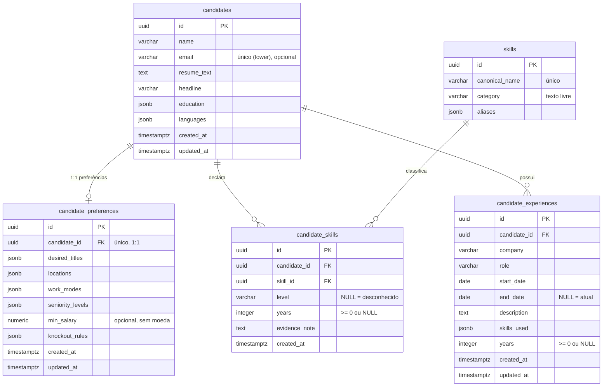

# JobPilot AI — Modelo de dados

> Estado do esquema criado pelas migrações Alembic. Atualizar sempre que uma
> migração criar/alterar tabelas (gatilho A.2 do `GUIA_DOCS_E_GIT.md`).
> Última atualização: 2026-11-16 (F1-T01).

## Visão geral

- **Chaves primárias:** `UUID` em todas as tabelas (ADR 0010) — evita IDs
  sequenciais expostos e facilita mesclar dados de fontes diferentes.
- **Timestamps:** `TIMESTAMPTZ` com `now()` do servidor no `INSERT`
  (`created_at`/`updated_at`); `updated_at` também usa `now()` do servidor no
  `UPDATE`. Não dependem do relógio da aplicação.
- **JSONB:** `education`, `languages`, `aliases`, listas de preferência,
  `knockout_rules` e `skills_used` guardam JSON válido no banco; a estrutura
  interna é validada por Pydantic na camada de serviço (F1-T02).
- **Exclusão em cascata:** tudo que pertence ao candidato é removido junto
  (`ON DELETE CASCADE`). O catálogo `skills` **não** é apagado em cascata.
- **Migração:** `migrations/versions/000000000002_profile_tables.py`
  (`upgrade`/`downgrade` reversíveis).

## Diagrama

## Tabelas

### `candidates`

Perfil principal; no MVP é single-user, mas o esquema já é multiusuário.

| Coluna | Tipo | Regras |
|--------|------|--------|
| `id` | `UUID` | PK, gerada na aplicação (`uuid4`) |
| `name` | `varchar(200)` | obrigatório |
| `email` | `varchar(320)` | opcional; normalizado (trim + minúsculas) antes de gravar |
| `resume_text` | `text` | obrigatório |
| `headline` | `varchar(200)` | opcional |
| `education` | `jsonb` | obrigatório, default `[]` |
| `languages` | `jsonb` | obrigatório, default `[]` |
| `created_at`, `updated_at` | `timestamptz` | obrigatórios, default `now()` |

**Por que o e-mail é único sem CITEXT:** a aplicação normaliza para minúsculas
(`@validates`) e o banco garante a unicidade pelo índice funcional
`uq_candidates_email_lower` em `lower(email)`. `Joao@email.com` e
`joao@email.com` colidem. `NULL` é permitido e pode repetir.

### `candidate_preferences` (1:1)

| Coluna | Tipo | Regras |
|--------|------|--------|
| `id` | `UUID` | PK |
| `candidate_id` | `UUID` | FK → `candidates.id`, `ON DELETE CASCADE`, **único** |
| `desired_titles` | `jsonb` | lista, default `[]` |
| `locations` | `jsonb` | lista, default `[]` |
| `work_modes` | `jsonb` | lista, default `[]` |
| `seniority_levels` | `jsonb` | lista, default `[]` |
| `min_salary` | `numeric(12,2)` | opcional; **sem coluna de moeda** nesta fase |
| `knockout_rules` | `jsonb` | default `{}` |
| `created_at`, `updated_at` | `timestamptz` | default `now()` |

### `skills`

| Coluna | Tipo | Regras |
|--------|------|--------|
| `id` | `UUID` | PK |
| `canonical_name` | `varchar(200)` | obrigatório, **único** |
| `category` | `varchar(100)` | opcional; texto livre até a taxonomia da F2-T01 |
| `aliases` | `jsonb` | lista PT/EN, default `[]` |

### `candidate_skills`

| Coluna | Tipo | Regras |
|--------|------|--------|
| `id` | `UUID` | PK |
| `candidate_id` | `UUID` | FK → `candidates.id`, `ON DELETE CASCADE` |
| `skill_id` | `UUID` | FK → `skills.id`, `ON DELETE CASCADE` |
| `level` | `varchar(20)` | opcional (`NULL` = desconhecido); CHECK: `iniciante`, `intermediário`, `avançado` |
| `years` | `integer` | opcional; CHECK `years >= 0` (anos usando a habilidade) |
| `evidence_note` | `text` | opcional |
| `created_at` | `timestamptz` | default `now()` |

**Único:** `(candidate_id, skill_id)` — o mesmo candidato não repete a skill.
**Semântica do NULL:** nível desconhecido/não informado — **nunca** significa
"não possui a habilidade".

### `candidate_experiences`

| Coluna | Tipo | Regras |
|--------|------|--------|
| `id` | `UUID` | PK |
| `candidate_id` | `UUID` | FK → `candidates.id`, `ON DELETE CASCADE` |
| `company` | `varchar(200)` | obrigatório |
| `role` | `varchar(200)` | obrigatório |
| `start_date` | `date` | obrigatório |
| `end_date` | `date` | opcional (`NULL` = vínculo atual); CHECK `end_date >= start_date` quando informada |
| `description` | `text` | opcional |
| `skills_used` | `jsonb` | lista, default `[]` |
| `years` | `integer` | opcional; CHECK `years >= 0` (anos naquela função) |
| `created_at`, `updated_at` | `timestamptz` | default `now()` |

## Constraints nomeadas

| Nome | Tabela | Regra |
|------|--------|-------|
| `uq_candidates_email_lower` | `candidates` | índice único em `lower(email)` |
| `uq_candidate_preferences_candidate_id` | `candidate_preferences` | 1:1 com candidato |
| `uq_skills_canonical_name` | `skills` | nome canônico único |
| `uq_candidate_skills_candidate_skill` | `candidate_skills` | par candidato/skill único |
| `ck_candidate_skills_level` | `candidate_skills` | valores de nível permitidos |
| `ck_candidate_skills_years_non_negative` | `candidate_skills` | `years >= 0` |
| `ck_candidate_experiences_date_range` | `candidate_experiences` | `end_date` não anterior ao início |
| `ck_candidate_experiences_years_non_negative` | `candidate_experiences` | `years >= 0` |

## Testes do esquema

`tests/db/test_profile_constraints.py` valida, contra PostgreSQL real:

- normalização e unicidade case-insensitive do e-mail; `NULL` repetível;
- unicidade 1:1, nome canônico e par candidato/skill;
- FKs e `ON DELETE CASCADE` (dependentes removidos, catálogo preservado);
- CHECKs de nível (incluindo `NULL`), intervalo de datas e anos negativos;
- `Numeric(12,2)` preservando duas casas.

O banco de teste é isolado (`jobpilot_test`), criado pela fixture a partir de
`TEST_DATABASE_URL` (default derivado de `DATABASE_URL`), com
`alembic upgrade head` na sessão. A fixture **aborta** se o alvo não terminar
em `_test` ou for igual ao banco de desenvolvimento.

## Próximas tabelas (fora desta tarefa)

`jobs`/`import_batches` (F1-T03), `applications`/`application_status_history`
(F1-T09) e, nas fases seguintes, `job_skills`, `job_matches`, `llm_cache`,
`pipeline_runs`, `resume_versions` e `interviews` (ver `PLANO.md` §5).

## Pendência registrada

O `PLANO.md` §5.1 previa `years` em `candidate_skills`; a decisão de
2026-11-16 também alocou `years` em `candidate_experiences` (anos na função).
As duas colunas existem com o mesmo CHECK, mas a duplicidade semântica deve
ser confirmada com o JP antes de a F1-T02 usar esses campos.
